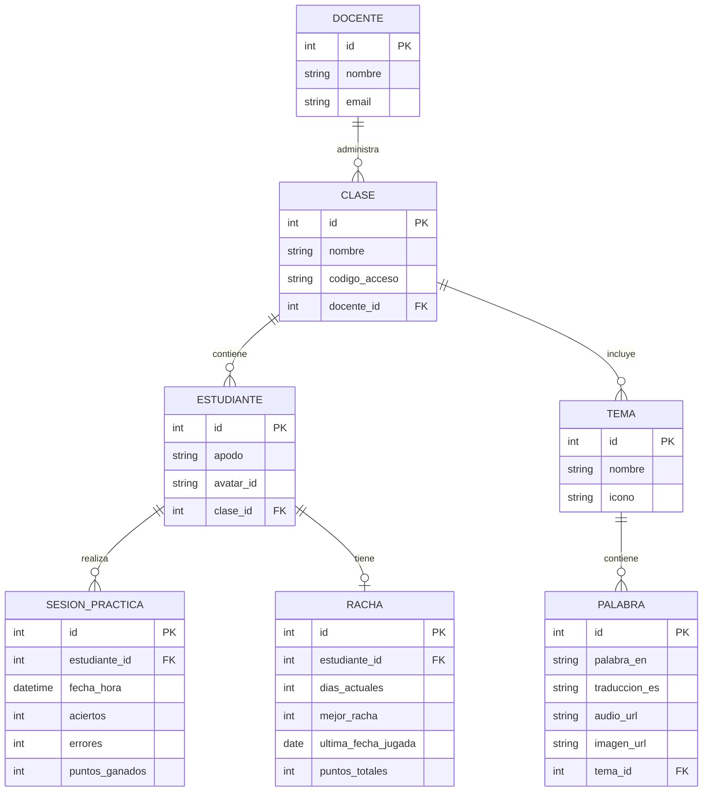

# Plan técnico: Plataforma Lúdica de Inglés

## Arquitectura

La aplicación sigue un diseño por capas desacopladas:
- **`app/rutas/`**: Endpoints FastAPI y vistas Jinja2 (sin lógica de negocio).
- **`app/servicios/`**: Lógica de negocio pura (cálculo de racha diaria, asignación de puntos, validación de sesiones).
- **`app/modelos/`**: Entidades y tablas definidas con SQLModel (SQLite en local, PostgreSQL en Render).
- **`app/templates/` y `app/static/`**: Interfaz HTML5 responsiva y PWA para instalación en móviles.

---

## Modelo de datos

---

## Contrato de API

| Método | Ruta | Descripción | Respuesta |
|---|---|---|---|
| GET | `/salud` | Verificación de estado del servidor | `{"estado": "ok"}` |
| GET | `/api/proyecto` | Metadatos y datos del aprendiz | Objeto `DatosProyecto` |
| POST | `/api/clases/entrar` | Valida código de clase y retorna avatares | Lista de estudiantes/avatares |
| POST | `/api/estudiantes/sesion` | Inicia sesión del niño con su avatar | Token o sesión activa |
| GET | `/api/estudiantes/{id}/racha` | Obtiene racha actual y puntos acumulados | `{"dias": int, "puntos": int}` |
| POST | `/api/actividades/completar` | Registra resultado y actualiza racha | Resultado y bonificación |
| GET | `/api/docente/clase/{id}/reporte`| Métricas de avance de los estudiantes | Resumen para el docente |

---

## Decisiones arquitectónicas (ADR)
Las decisiones de diseño clave se encuentran documentadas en [`specs/adr/`](file:///C:/Users/Aprendiz/Documents/tarea4/plantilla-plataforma-ludica/specs/adr/).
