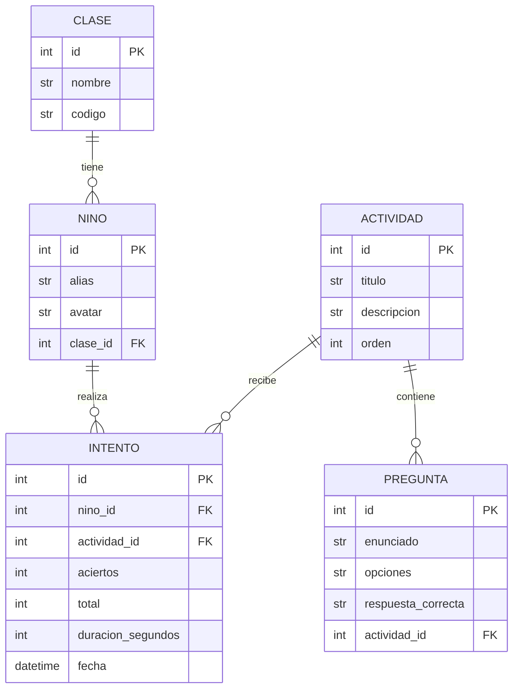

# Plan técnico: Plataforma Lúdica de Inglés

## Arquitectura

La aplicación sigue un diseño por capas desacopladas:
- **`app/rutas/`**: Endpoints FastAPI y vistas Jinja2 (sin lógica de negocio).
- **`app/servicios/`**: Lógica de negocio pura (gestión de actividades, cálculo de racha diaria, validación de sesiones).
- **`app/modelos/`**: Entidades y tablas definidas con SQLModel (SQLite en local, PostgreSQL en Render).
- **`app/esquemas.py`**: Esquemas de Pydantic para validación de entrada y serialización de respuestas.
- **`app/db.py`**: Motor de conexión, creación de tablas y dependencia de sesión por petición.
- **`app/templates/` y `app/static/`**: Interfaz HTML5 responsiva y PWA para instalación en móviles.

---

## Modelo de datos

---

## Contrato de API

| Método | Ruta | Descripción | Respuesta |
|---|---|---|---|
| GET | `/salud` | Verificación de estado del servidor | `{"estado": "ok"}` |
| GET | `/api/proyecto` | Metadatos y datos del aprendiz | Objeto `DatosProyecto` |
| GET | `/api/version` | Versión actual del proyecto | `{"version": str}` |
| GET | `/api/actividades` | Lista de actividades ordenadas por `orden` con sus preguntas | `200` |
| POST | `/api/actividades` | Crea una actividad con sus preguntas (mínimo 5) | `201` / `422` |
| GET | `/api/actividades/{id}` | Consulta una actividad por identificador | `200` / `404` |
| PUT | `/api/actividades/{id}` | Actualiza una actividad y reemplaza sus preguntas | `200` / `404` / `422` |
| DELETE | `/api/actividades/{id}` | Elimina una actividad y sus preguntas asociadas | `204` / `404` |

---

## Decisiones arquitectónicas (ADR)

Las decisiones de diseño clave se encuentran documentadas en `specs/adr/`.
